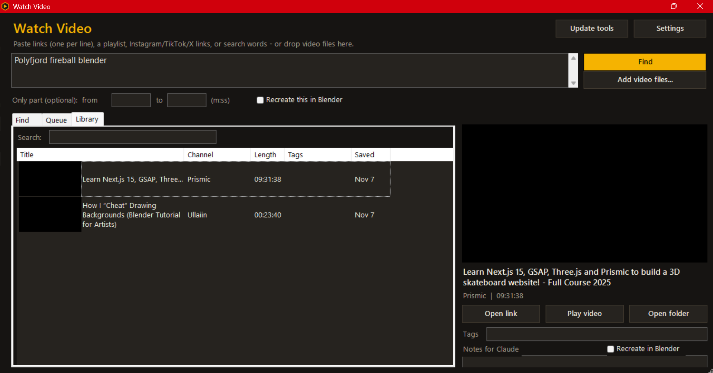

# Watch Video

A small Windows app that turns any video into something an AI assistant like Claude can "watch": a timestamped transcript, frame sheets with a timestamp on every frame, and a short `claude.md` note saying what you want.

## What it does

- **Find videos:** paste a YouTube link or playlist, Instagram, TikTok or X links, or just type a search. You pick the right result from thumbnails.
- **Preview** each video (thumbnail, title, channel, length) before you commit.
- **Your own files:** drag in an MP4 (screen recordings, renders, clips) or click *Add video files...*
- **Queue:** tick several videos and let it work through them.
- **Smart frames:** grabs a frame whenever the picture changes plus regular ones in between, stamps the time on each frame, and uses more frames for short clips.
- **Only part:** focus on one section, such as `9:00` to `14:30`.
- **Transcripts:** uses captions when the video has them, or optional offline speech-to-text (Whisper) when it doesn't.
- **Library:** thumbnails, search, tags, notes, a *Recreate in Blender* flag, and *Save space* to delete the big video file but keep the transcript and frames.
- **Send to Claude:** writes `claude.md` and copies a one-line message to paste into your chat.

## Install (Windows 10/11)

1. Click the green **Code** button, then **Download ZIP** (or grab the ZIP from **Releases**).
2. Unzip it somewhere you'll keep it, like `Videos\watch`.
3. Double-click **`install-app.cmd`**. It installs yt-dlp and FFmpeg the first time (through winget) and puts a **Watch Video** icon on your desktop.

Optional:
- **`build-exe.cmd`** turns the app into a real `Watch Video.exe` with its own icon.
- **Settings > Install speech-to-text** sets up Python and faster-whisper for videos with no captions.

## Using it with Claude

1. Find a video, tick it, and click **Watch ticked videos**.
2. When it's done, select it in **Library**, add notes if you want, and click **Send to Claude**.
3. Paste the message into a Claude chat that can reach your files (the Claude desktop app with your watch folder connected), or upload the video's folder: `transcript.txt`, `sheet_*.jpg`, `frames.txt` and `claude.md`.

Everything is saved in `watch-output\<video>\` next to the app.

## Files

| File | What it is |
|---|---|
| `watch-app.ps1` | The app window |
| `watch-core.ps1` | Downloads the video and makes the transcript and frame sheets |
| `transcribe.py` | Speech-to-text for videos without captions |
| `install-app.cmd` | One-time setup and desktop shortcut |
| `build-exe.cmd` | Optional: builds `Watch Video.exe` |
| `watch.ico` | App icon |

## Troubleshooting

- **"yt-dlp not found"**: click **Update tools** in the app, or run `install-app.cmd` again.
- **A video won't download**: click **Update tools**. YouTube changes often and older yt-dlp versions stop working.
- **Certificate errors**: the app already uses the Windows certificate store (`--compat-options no-certifi`).

## Please note

This is for personal study and reference, like learning from tutorials. Respect creators and the terms of the sites you download from, and don't re-upload other people's videos.

## Credits

Built by **i4ity** with Claude. Uses [yt-dlp](https://github.com/yt-dlp/yt-dlp), [FFmpeg](https://ffmpeg.org) and [faster-whisper](https://github.com/SYSTRAN/faster-whisper). MIT License.
